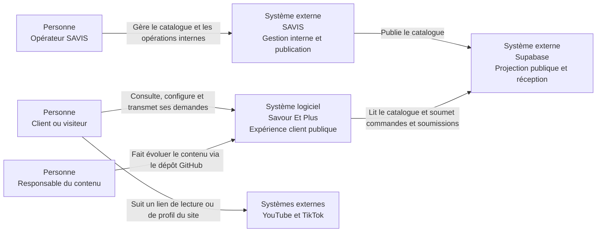
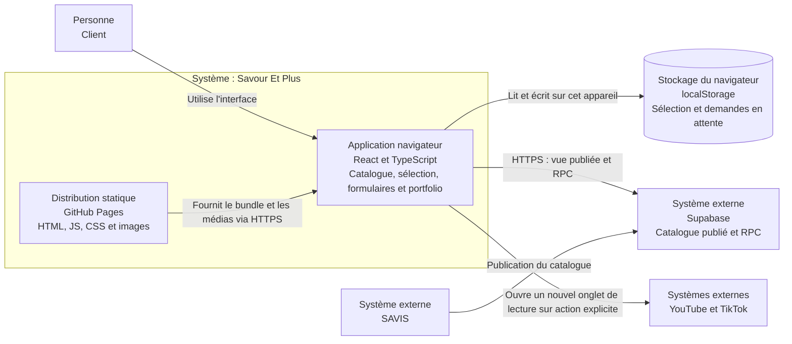
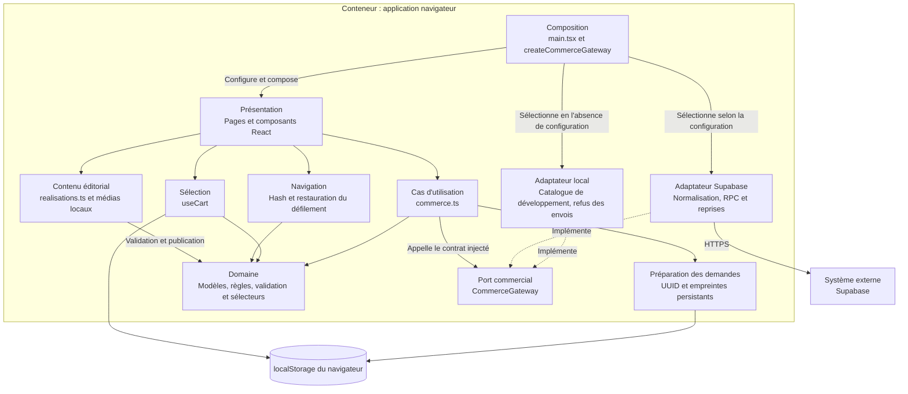
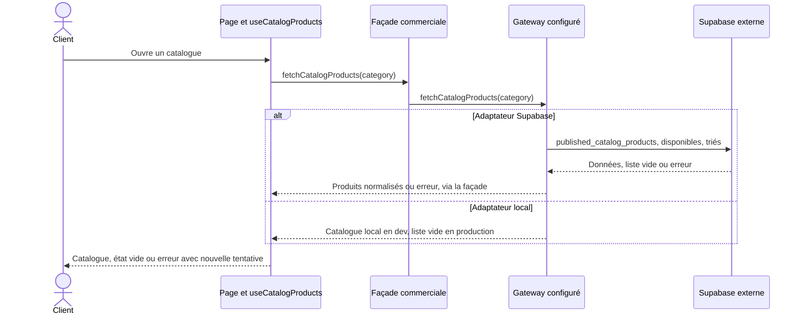
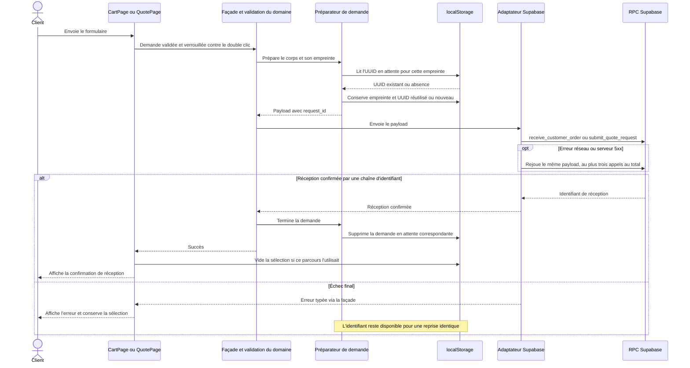
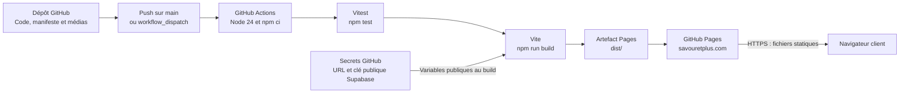

# Architecture de Savour Et Plus

Ce document décrit l'architecture actuelle selon des vues C4 de contexte,
conteneurs et composants, complétées par des flux d'exécution, la propriété des
données et la livraison. Il constitue la référence des frontières et contrats.
Le [README](../README.md) sert de point d'entrée; les instructions d'installation,
de vérification et de diagnostic appartiennent au [guide de développement](developpement.md).
Les procédures de contenu restent dans le [guide éditorial](ajouter-une-realisation.md).

L'organisation s'inspire de [l'architecture C4 de SAVIS](https://github.com/wiljeanlouis/savis/blob/main/docs/ARCHITECTURE.md),
adaptée au périmètre de ce frontend. Les vues reflètent les sources du dépôt au
27 octobre 2026; elles ne certifient pas l'état d'une instance déployée.

## Navigation du document

- [Périmètre](#périmètre)
- [Principes structurants](#principes-structurants)
- [Contexte système — C4 niveau 1](#contexte-système--c4-niveau-1)
- [Conteneurs — C4 niveau 2](#conteneurs--c4-niveau-2)
- [Composants — C4 niveau 3](#composants--c4-niveau-3)
- [Navigation et hébergement statique](#navigation-et-hébergement-statique)
- [Catalogue commercial](#catalogue-commercial)
- [Sélection persistante](#sélection-persistante)
- [Commandes et soumissions](#commandes-et-soumissions)
- [Flux d'exécution](#flux-dexécution)
- [Portfolio, accueil et réseaux sociaux](#portfolio-accueil-et-réseaux-sociaux)
- [Propriété des données](#propriété-des-données)
- [Caractéristiques opérationnelles](#caractéristiques-opérationnelles)
- [Architecture de livraison](#architecture-de-livraison)
- [Règles architecturales](#règles-architecturales)
- [Limites connues](#limites-connues)

## Périmètre

Savour Et Plus est le site public de catalogue, de configuration de produits,
de sélection persistante, de réception de commandes et de demandes de soumission.
Il présente aussi des réalisations et témoignages gérés dans GitHub.

Le système est une application statique React/TypeScript, produite par Vite et
stylée avec Tailwind CSS. Il ne possède ni serveur métier, ni authentification
client, ni base de données propre. Il ne porte pas les BOM, coûts internes,
opérations ou migrations de SAVIS. Supabase expose la projection publique du
catalogue et reçoit les demandes; SAVIS possède le modèle métier interne.
Une réception technique n'équivaut pas à une commande opérationnelle confirmée.

### Conventions des diagrammes

Les diagrammes utilisent Mermaid pour être lisibles sur GitHub. Les niveaux
C4 décrivent des périmètres différents, pas des environnements supplémentaires.
« Conteneur » désigne une unité d'exécution ou de distribution C4, pas un conteneur
Docker. Le navigateur héberge l'application et son stockage local; les fichiers
statiques sont servis par GitHub Pages. Les composants du niveau 3 sont des
modules logiques dans un seul bundle, sans services réseau indépendants.

Le niveau 4, consacré aux classes et au code, est laissé aux sources et aux tests.
La référence visuelle appelée « C2 » dans `design/` est un nom de design distinct
du niveau 2 du modèle C4.

## Principes structurants

| Principe | Conséquence dans ce dépôt |
| --- | --- |
| Distribution statique | Routage par hash, ressources relatives, aucun serveur applicatif à déployer |
| Ports et adaptateurs | Les composants utilisent la façade; le backend implémente `CommerceGateway` |
| Domaine indépendant | Règles, configurations et validations ne dépendent ni de React ni de Supabase |
| Propriété explicite | Le navigateur possède la sélection; Supabase reçoit les demandes; SAVIS porte le métier interne |
| Commande et soumission distinctes | Décoration sans prix artificiel, demande mixte sans ajout d'un service |
| Reprise idempotente | Même corps de demande, même UUID en attente; conservation après échec |
| Édition statique du portfolio | Manifeste et médias versionnés, sans CMS ou base supplémentaire |

## Contexte système — C4 niveau 1



Le navigateur ne contacte pas directement l'API SAVIS. Le traitement interne
ultérieur des demandes relève de SAVIS et de ses procédures, hors du périmètre
de cette application. YouTube et TikTok sont ouverts par une action explicite;
ils ne fournissent pas de lecteur intégré ni de script au chargement de la page.

## Conteneurs — C4 niveau 2



| Élément | Responsabilité | État |
| --- | --- | --- |
| Application navigateur | Rendu, navigation, validation, calculs estimatifs, appels commerciaux | État React et mémoire de navigation |
| Distribution GitHub Pages | Sert le résultat du build et les ressources publiques | Fichiers immuables entre deux déploiements |
| `localStorage` | Persistance sur le navigateur courant, sans synchronisation | Sélection et empreintes/UUID de demandes |
| Supabase externe | Lecture publique filtrée et réception des payloads | Projection et demandes reçues, schéma géré dans SAVIS |
| SAVIS externe | Modèle métier interne et publication | Données internes hors de ce dépôt |

`localStorage` est une capacité du navigateur, pas une base serveur ou un
conteneur déployé séparément. Le manifeste éditorial et les images locales font
partie du build; ils ne sont pas lus dans Supabase. En développement, Vite remplace
la distribution GitHub Pages; il ne devient pas un backend métier.

## Composants — C4 niveau 3



Les flèches pleines indiquent une utilisation ou un appel; les flèches pointillées
indiquent l'implémentation du contrat. Le port reste indépendant des adaptateurs.
`main.tsx` configure la façade avec `createCommerceGateway()`, compose `Header`,
la page active et `Footer`, puis partage `useCart()` avec les pages concernées.

### Correspondance avec les sources

| Chemin | Responsabilité |
| --- | --- |
| `src/domain/catalog.ts` | Catalogue, formats, choix, ingrédients, slugs |
| `src/domain/cart.ts` | Identité, restauration, mutation et éligibilité de la sélection |
| `src/domain/quote.ts` | Types de demande, paramètres, sélection et construction des soumissions |
| `src/domain/commercialValidation.ts` | Validation et normalisation des formulaires commerciaux |
| `src/domain/customerOrderReception.ts`, `src/domain/quoteReception.ts` | Contrats de réception et erreurs typées |
| `src/domain/realisation.ts` | Modèle et validation du portfolio, publication et sélecteurs |
| `src/domain/navigation.ts` | Analyse des routes par hash |
| `src/application/commerce.ts` | Façade et validation avant appel du port |
| `src/application/customerOrderRequest.ts`, `src/application/quoteRequest.ts` | Identifiants persistants et préparation des demandes |
| `src/application/cart/useCart.ts` | État React partagé de la sélection et persistance |
| `src/application/navigation/` | Événements de navigation et restauration du défilement |
| `src/infrastructure/` | Choix du gateway, catalogue local et normalisation Supabase |
| `src/components/` | Fonctionnalités `home`, `catalog`, `cart`, `quote`, `services`, `contact`, `realisations`, `forms`, `layout`, `ui` |
| `src/content/realisations.ts` | Réalisations et témoignages éditoriaux |
| `src/shared/` | Formatage en CAD/français canadien et utilitaires |
| `test/` | Tests de domaine, cas d'utilisation, adaptateurs et composants |

La couche domaine ne dépend ni de React ni de Supabase. Les composants utilisent
la façade et les hooks; la normalisation distante reste dans l'infrastructure.
Un futur adaptateur doit implémenter le même port. `ServicePage.tsx` et
`HeroSlideshow.tsx` existent encore, mais ne sont pas montés dans les routes et
l'accueil actuels; ne pas les confondre avec `ServicesPage` et `HeroSection`.


## Navigation et hébergement statique

Les routes sont analysées dans `domain/navigation.ts`. Le hook
`application/navigation/useHashNavigation.ts` écoute `hashchange` et `popstate`;
`main.tsx` sélectionne la page. Vite utilise `base: "./"`, les ressources de
`public/` ont des chemins relatifs et le routage n'exige aucune réécriture serveur.

L'application utilise des URL par hash, compatibles avec GitHub Pages.

| Route | Page |
| --- | --- |
| `#/accueil` | Accueil C2 |
| `#/decoration` | Catalogue Décoration |
| `#/decoration/:slug` | Fiche d'un produit Décoration publié |
| `#/degustation` | Catalogue Dégustation et configuration |
| `#/services` | Présentation des services |
| `#/realisations` | Portfolio et filtres |
| `#/realisations/:slug` | Fiche multimédia d'une réalisation publiée |
| `#/panier` | Ma sélection et commande directe |
| `#/soumission` | Formulaire centralisé de soumission |
| `#/contact` | Téléphones, courriel, YouTube et TikTok |

Paramètres reconnus :

- `#/accueil?section=realisations` et
  `#/degustation?section=catalogue-degustation` pour rejoindre une section;
- `#/decoration?categorie=arche-de-ballon`, `centre-de-table`, `anniversaire`
  ou `mariage`; `#/decoration?section=autres` pour les produits non classés;
- `#/soumission?service=...` avec `traiteur`, `decoration`, `organisation`,
  `decoration-organisation`, `traiteur-decoration` ou
  `traiteur-decoration-organisation`;
- `#/soumission?service=decoration&item=:slug` pour présélectionner un article;
- `#/soumission?service=traiteur-decoration&source=selection` pour reprendre
  une sélection mixte. Le service doit correspondre aux catégories sélectionnées.

Un chemin inconnu revient à l'accueil. Une fiche avec un slug valide mais absent
ou non publié affiche un état introuvable.

Un slug de fiche malformé revient à l'accueil; un slug valide non résolu donne
un état introuvable. Aucun alias historique de page n'est maintenu.

La navigation conserve les positions par entrée d'historique en mémoire.
Une nouvelle page repart en haut, Précédent/Suivant restaure la position connue
et les sections explicites ont priorité. Un changement de paramètres de la même
page ne déclenche pas de retour systématique en haut. Le défilement animé respecte
`prefers-reduced-motion`. Les catégories Décoration sont résolues dans
`domain/decoration.ts` et défilent après chargement du catalogue.

## Catalogue commercial

Le port `CommerceGateway` expose :

```ts
fetchCatalogProducts(category?: CatalogCategory): Promise<CatalogProduct[]>;
receiveCustomerOrder(payload: ReceiveCustomerOrderPayload): Promise<string>;
submitQuoteRequest(payload: ReceiveQuoteRequestPayload): Promise<string>;
```

`createCommerceGateway()` sélectionne Supabase si l'URL et la clé publique sont
présentes. Sinon il instancie `LocalCommerceGateway(!import.meta.env.PROD)`.
Le catalogue local est donc exposé en développement seulement; un build sans
configuration retourne une liste vide. Les deux écritures locales échouent
explicitement, sans réception simulée.

L'adaptateur Supabase lit `published_catalog_products`, sélectionne les champs,
filtre `is_available = true`, trie par `display_order` et applique éventuellement
`category`. Une erreur est propagée; une liste vide reste vide. Il n'existe pas
de bascule automatique vers le catalogue local après un échec distant.
`useCatalogProducts()` expose chargement, erreur, liste et nouvelle tentative.

La normalisation convertit les montants et quantités en nombres, complète les
champs absents, écarte les entrées sans identité/slug/nom et les produits
Dégustation sans format d'achat. Une catégorie distante inconnue devient
`tasting`; une sous-catégorie inconnue devient `null`. Les sous-catégories connues
sont `decorative-arch`, `centerpiece`, `birthday`, `wedding`. La Décoration
non classée reste dans « Autres décorations ». Les images et notes absentes
reçoivent des valeurs de secours pour Dégustation; les valeurs Décoration peuvent
rester vides.

Les quatre types de produits sont `standard`, `single_choice`,
`single_choice_bundle`, `ingredient_customization`. Les formats indiquent une
allocation `none`, `single_choice` ou `choice_allocation`. La répartition d'un
bundle doit atteindre les unités du format. Seuls les ingrédients au-dessus de
`default_quantity` ajoutent un supplément. Tous les calculs monétaires utilisent
les cents; `shared/format.ts` affiche le CAD en français canadien.

### Catalogue Décoration

Le catalogue et les fiches suivent la [référence visuelle C2](../design/reference/homepage-c2.png)
et réutilisent les primitives et couleurs de `src/styles.css`. Leur implémentation
se trouve dans `src/components/catalog/page/DecorationCatalogPage.tsx` et
`src/components/catalog/page/DecorationDetailPage.tsx`. La galerie produit
`src/components/catalog/ProductGallery.tsx` reste distincte de la galerie
multimédia du portfolio.

La taxonomie de `src/domain/decoration.ts` associe les codes métier aux liens publics :

| Sous-catégorie métier | Paramètre public `categorie` | Libellé |
| --- | --- | --- |
| `decorative-arch` | `arche-de-ballon` | Arche décorative |
| `centerpiece` | `centre-de-table` | Centre de table |
| `birthday` | `anniversaire` | Anniversaire |
| `wedding` | `mariage` | Mariage |

Les liens `#/decoration?categorie=...` défilent vers la catégorie après chargement.
Une catégorie connue sans produits mène à la proposition sur mesure. Les produits
sans sous-catégorie reconnue restent dans « Autres décorations », accessible avec
`#/decoration?section=autres` lorsqu'il y en a. Le CTA du hero utilise actuellement
`?section=catalogue`, mais l'effet de défilement ne traite que `categorie` et
`section=autres` : ce lien ne garantit pas le défilement vers le catalogue.

Les pages distinguent chargement, erreur avec nouvelle tentative, liste vide et
produit indisponible. Les fiches montrent nom, description, sous-catégorie, image,
galerie et note de disponibilité lorsqu'elle est fournie. « Ajouter à ma sélection »
conserve quantité et préférences. Le lien
`#/soumission?service=decoration&item=:slug` présélectionne l'article; la résolution
transmet ensuite son véritable `CatalogProduct.id`, pas le slug, au backend.

Les pages Décoration n'affichent ni tarif ni modalités de commercialisation
inventées. Le modèle ne distingue pas de façon structurée location, achat,
installation, livraison ou démontage. Ces informations exigent une évolution du
modèle propriétaire avant de devenir des promesses dans l'interface.

## Sélection persistante

`useCart()` expose `items`, `count`, `totalCents`, `add`, `addDecoration`,
`updateQuantity`, `updateNote`, `remove` et `clear`. Le stockage
`savouretplus-cart` utilise `{ version: 2, items }`. La restauration accepte
l'ancien tableau brut, normalise les champs et ignore les lignes malformées.
Une sous-catégorie inconnue devient `null` sans supprimer le produit. Les lignes
conservent catégorie, sous-catégorie, slug public, quantité, image et note éventuelle.
Si le stockage est indisponible, la sélection reste utilisable en mémoire, sans
persistance garantie au rechargement.

Une ligne Dégustation tarifée utilise `pricing: "known"`; une décoration utilise
`pricing: "quote"`, avec prix de base et unitaire `null`. Le total porte sur
les lignes tarifées, sans attribuer de prix implicite aux autres : ce total partiel
ne représente pas le prix complet d'une sélection mixte.

L'identité Dégustation combine produit, format, choix, répartition et ingrédients.
L'identité Décoration combine produit et préférences. Les lignes identiques
fusionnent leurs quantités; modifier une préférence peut fusionner deux lignes.
Le compteur additionne les quantités. La sélection n'est ni authentifiée ni
synchronisée entre appareils.

## Commandes et soumissions

| Sélection | Commande directe | Type de soumission |
| --- | --- | --- |
| Dégustation seule, valide et tarifée | Oui | `traiteur` |
| Décoration seule | Non | `decoration` |
| Mixte Dégustation et Décoration | Non | `traiteur-decoration` |

`CartPage` propose la commande directe uniquement si toutes les lignes sont
éligibles. `buildSelectionQuoteHash()` construit le lien
`#/soumission?service=...&source=selection`. `QuotePage` reprend les lignes en conservant
leur véritable identifiant produit, quantité, configuration et note. Le service
doit correspondre aux catégories de la sélection. Organisation n'est jamais
ajoutée pour transformer une demande mixte : celle-ci transmet exactement
`["traiteur", "decoration"]`. La validation frontend et les tests couvrent ce
payload; son acceptation par une instance réelle doit être vérifiée avec
SAVIS/Supabase, dont les migrations n'appartiennent pas à ce dépôt.

Les six types reconnus sont `traiteur`, `decoration`, `organisation`,
`decoration-organisation`, `traiteur-decoration` et
`traiteur-decoration-organisation`. `requested_services` doit correspondre
exactement au type. Les invités sont pertinents pour traiteur/organisation,
les allergies pour traiteur. Les items sont validés lorsqu'ils sont présents;
la validation actuelle n'impose pas un item traiteur à toute soumission.

`item=:slug` présélectionne une décoration uniquement pour un service comprenant
Décoration. La résolution utilise le catalogue courant, puis transmet le véritable
`product.id` comme `offering_id`. Le slug n'est pas un identifiant backend.

### Contrats de réception

Les deux RPC reçoivent `{ payload }` et doivent retourner une chaîne d'identifiant
de réception. L'absence de chaîne est une erreur technique. Les types sources
font foi; les listes ci-dessous décrivent les champs principaux :

| RPC | Corps `payload` |
| --- | --- |
| `receive_customer_order` | `request_id`, `customer_name`, `customer_phone`, `customer_email`, `note`, `total_cents`, `items` |
| `submit_quote_request` | `request_id`, `type: "QUOTE_REQUEST"`, `customer`, `requested_services`, `event_details`, `items` |

Les items de commande conservent clé, `product_id`, nom, catégorie, type,
image, quantité, prix en cents, format, choix, répartition et ingrédients.
Les items de soumission portent `offering_id`, nom, `requested_quantity`,
`configuration` et note. `event_details` contient type de demande, type/date/heure
et adresse de l'événement, invités, budget, allergies et note. Les types exacts
se trouvent dans `domain/customerOrderReception.ts`,
`domain/commercialValidation.ts` et `domain/quoteReception.ts`.

Les coordonnées et payloads passent par `validateCustomerOrder()` ou
`validateQuoteRequest()` avant préparation. Les téléphones utilisent
`libphonenumber-js`, avec contexte canadien par défaut et normalisation
internationale. Une validation frontend ne remplace pas celle de Supabase/SAVIS.

### Idempotence, erreurs et reprises

Les préparateurs calculent une empreinte du corps de demande et conservent un
UUID pour un corps identique sous :

- `savouretplus-pending-customer-order-v1`;
- `savouretplus-pending-quote-request-v1`.

Les enveloppes de ces deux stockages portent `version: 1`, `requestId` et
`fingerprint`, sans y recopier le corps complet. Une modification du corps crée
un nouvel UUID. En cas de refus du stockage, la protection reste en mémoire
pour la session; elle ne couvre plus un rechargement. Un verrou de soumission
empêche les doubles appels simultanés dans chaque formulaire.

L'adaptateur tente au plus trois appels sur les erreurs réseau et réponses
serveur 5xx, avec attentes de 250 puis 500 ms. Il distingue erreurs de validation,
conflits d'idempotence, réseau et techniques. Les erreurs métier ne sont pas
rejouées automatiquement. Aucun timeout explicite n'est configuré par ce code.

La façade supprime l'identifiant en attente seulement après réception confirmée.
`CartPage` vide la sélection après une commande confirmée; `QuotePage` la vide
après une soumission confirmée issue de `source=selection`. Une erreur conserve
les données de sélection et permet une reprise avec le même identifiant.

## Flux d'exécution

### Chargement du catalogue



Le choix du gateway se fait à la composition. Une erreur du gateway distant
n'entraîne pas de nouvelle lecture sur le gateway local.

### Réception de commande ou de soumission



L'adaptateur local refuse les écritures sans appeler Supabase. Le stockage de
sélection est mis à jour par `useCart()` après la confirmation; le diagramme
regroupe ces étapes pour montrer le résultat observable. Un refus du stockage
conserve seulement les protections en mémoire décrites plus haut.

### Navigation du portfolio

Le manifeste est validé au chargement, filtré par publication puis résolu par
slug. La sélection d'une miniature met à jour l'aperçu et sa légende. Une photo
peut ouvrir la lightbox; une vidéo reste un aperçu jusqu'au clic sur son lien de
lecture. Aucune réception commerciale ni écriture Supabase n'intervient dans ce flux.

## Portfolio, accueil et réseaux sociaux

`content/realisations.ts` est validé au chargement. Chaque réalisation possède un
`id`, un `slug` et une référence permanente `REA-0001` à `REA-9999` uniques, même
pour une entrée masquée. Elle conserve au moins une photographie; `coverImage`
doit appartenir à `images`. `published` contrôle grille et résolution de fiche.
Les codes de catégorie sont `decoration`, `cartering` (orthographe historique)
et `decoAndCatering`; ils sont distincts de ceux du catalogue commercial.

Le tableau `images` reste compatible avec les anciennes entrées, sans type
obligatoire. `videos` est facultatif, avec `type: "video"`, plateforme
`youtube`/`tiktok`, URL HTTPS et titre obligatoires. Une miniature locale fournie
exige son texte alternatif. `getOrderedRealisationMedia()` construit une union
`image`/`video` et trie par `displayOrder`. Les règles détaillées et un exemple
non publié figurent dans [le guide éditorial](ajouter-une-realisation.md).

La fiche conserve galerie à gauche et informations/témoignages à droite sur
desktop. Les miniatures sélectionnent le média sans ouvrir de plateforme.
La lecture externe nécessite une action explicite et utilise un nouvel onglet
avec `noopener noreferrer`. Aucun iframe ni script tiers n'est chargé.
La lightbox parcourt les photos uniquement, avec flèches, Échap, focus contenu
et retour au déclencheur. La zone d'aperçu garde une hauteur stable; l'absence
ou l'échec d'une miniature affiche un repli accessible.

Les couvertures du portfolio, de l'accueil et des témoignages restent des
photographies. Les témoignages appartiennent aux réalisations; le sélecteur
retient `featuredOnHome: true` seulement sur les entrées publiées.
`homeImageSrc`, lorsqu'il est fourni, doit viser une photo de la même réalisation.
Le carrousel de témoignages est manuel, absent sans sélection et sans flèches
pour un avis unique. Le hero actuel est statique; l'ancien `HeroSlideshow`
automatique n'est pas monté. La section « Dans les coulisses » a été supprimée.

Les cinq réalisations actuelles incluent trois liens TikTok (Winnie, Marvensley,
bouquet bleu et or). Les aperçus configurés réutilisent des photos des réalisations;
ils ne constituent pas des captures vidéo vérifiées. L'inventaire
[Ressources vidéo](medias-video.md) précise l'état réel des ressources.
Contact et le footer conservent YouTube et TikTok avec les icônes SVG locales
`YouTubeIcon` et `TikTokIcon`. Les URL communes sont définies dans `homeContent.ts`;
Contact utilise encore une URL YouTube littérale identique.

## Propriété des données

| Données | Propriétaire | Frontière de persistance |
| --- | --- | --- |
| BOM, coûts, règles et produits internes | SAVIS | Base et migrations internes, hors de ce dépôt |
| Projection du catalogue disponible | Publication SAVIS vers Supabase | `published_catalog_products`, lue par le site |
| Commandes et soumissions reçues | Supabase, traitement ultérieur selon SAVIS | RPC et schéma Supabase gérés dans le dépôt SAVIS |
| Sélection client | Navigateur courant | `savouretplus-cart`, version 2, compatible avec l'ancien tableau |
| Reprise d'une demande | Navigateur courant | Deux stockages version 1 contenant UUID et empreinte |
| Réalisations, témoignages et médias locaux | Responsable éditorial via GitHub | `src/content/realisations.ts` et `public/images/` |
| Catalogue de démonstration | Dépôt frontend | `src/infrastructure/local/fallbackCatalog.ts`, exposé en développement |

Les données locales ne sont pas une source de vérité commerciale. Un produit
traverse les frontières par son identifiant public; un slug reste un identifiant
de navigation. Une référence `REA-XXXX` est une référence éditoriale, pas une clé
étrangère backend. Le `request_id` identifie une tentative logique réutilisable;
il est distinct de l'identifiant de réception retourné par Supabase.

La documentation SAVIS distingue la réception dans Supabase de l'import et du
traitement interne des commandes. Elle indique aussi que les soumissions n'ont
pas encore de module métier SAVIS dédié. Ce site ne doit donc pas présenter une
réception RPC comme une confirmation de traitement opérationnel automatisé.

## Caractéristiques opérationnelles

### Persistance et reprise

Le site ne gère pas de session serveur. La sélection survit au rechargement si
le navigateur accepte `localStorage`; elle ne suit pas le client sur un autre
appareil. Les données de navigation restent en mémoire. Le verrou de formulaire
et les UUID persistants ont des rôles distincts : prévenir les appels simultanés
et permettre de rejouer une demande sans créer une nouvelle identité.

### Frontières de sécurité

- Les variables `VITE_SUPABASE_URL` et `VITE_SUPABASE_ANON_KEY` sont publiques
  dans le bundle; aucune clé serveur ou `service_role` n'appartient au frontend.
- Supabase/SAVIS valident les droits d'accès, payloads, prix et disponibilités;
  les validations client et le total affiché restent indicatifs.
- Le navigateur utilise uniquement les vues et RPC du port commercial. Il ne
  possède ni connexion SQL ni accès direct à l'API ou aux bases internes de SAVIS.
- Les liens vidéo sont limités aux hôtes HTTPS prévus et les ouvertures externes
  de lecture utilisent `noopener noreferrer`. La provenance des médias reste
  une validation éditoriale, pas une propriété prouvée par l'URL.

### Vérifiabilité

Vitest couvre domaine, orchestration, adaptateurs et rendu/gestionnaires de
composants; les adaptateurs sont testés avec des doubles de Supabase. La
vérification TypeScript couvre `src` et `vite.config.ts`, avec `strict: false`.
Aucun lint, test navigateur automatisé ou endpoint de santé applicatif n'est
configuré. Les contrôles de développement et d'intégration sont décrits dans
[le guide de développement](developpement.md), sans assimiler un test unitaire
à une preuve de fonctionnement d'un backend déployé.

## Architecture de livraison



Le workflow est défini dans [deploy.yml](../.github/workflows/deploy.yml).
Il exécute tests et build avant publication; il ne lance pas `typecheck`.
La configuration Supabase est injectée au build et ne peut pas être modifiée
par une variable serveur après déploiement. Le domaine est déclaré dans
[public/CNAME](../public/CNAME). Les mises à jour éditoriales nécessitent le même
build et déploiement que le code.

Le build local ne publie rien. Le script manuel `npm run deploy` utilise
`gh-pages`; il est distinct du workflow Pages. Ni publication, ni push sur `main`,
ni déclenchement du workflow ne doivent être exécutés sans demande explicite.
Les procédures et commandes de livraison sont dans [le guide de développement](developpement.md).

## Règles architecturales

1. Garder le domaine indépendant de React et de Supabase.
2. Passer par la façade et le port commercial, sans appel Supabase dans les composants.
3. Maintenir la normalisation distante dans l'adaptateur d'infrastructure.
4. Préserver routage par hash, `base: "./"` et chemins publics relatifs.
5. Calculer les estimations en cents; laisser les validations finales au backend.
6. Conserver des prix `null` pour Décoration et distinguer commande et soumission.
7. Transmettre exactement les services demandés et les véritables identifiants produits.
8. Préserver les configurations et la migration des sélections déjà enregistrées.
9. Réutiliser l'UUID d'une demande identique et ne vider la sélection qu'après réception.
10. Ne jamais simuler un succès en l'absence de backend.
11. Garder l'édition du portfolio dans GitHub, avec identité stable et provenance confirmée.
12. Laisser migrations et traitements internes à leur dépôt propriétaire SAVIS.

## Limites connues

- Le catalogue local n'est pas exposé dans un build de production sans Supabase;
  une panne du catalogue distant n'active pas de fallback local.
- `section=catalogue` dans le CTA du hero Décoration n'est pas traité par l'effet
  de défilement actuel. Les liens `categorie` et `section=autres` ont un traitement distinct.
- Le modèle Décoration n'expose pas de modalités structurées de location, achat,
  installation, livraison ou démontage.
- Les trois aperçus TikTok actuels sont des photos des réalisations, pas des
  captures vidéo vérifiées. La provenance de deux médias Services reste à
  compléter dans [l'inventaire](../design/image-inventory.md).
- Le stockage navigateur peut être refusé ou effacé; l'idempotence en mémoire
  ne protège pas un rechargement dans ce cas.
- Les reprises réseau sont bornées, mais aucun timeout explicite n'est configuré.
- TypeScript n'est pas strict; la CI Pages ne lance pas `typecheck` et aucun
  test navigateur n'est configuré.
- Les tests frontend ne prouvent pas la compatibilité des migrations, RPC ou
  politiques d'accès d'une instance SAVIS/Supabase réelle.
- Le traitement opérationnel des demandes reçues est extérieur à ce site et ne
  doit pas être déduit de la seule réussite d'une RPC.
